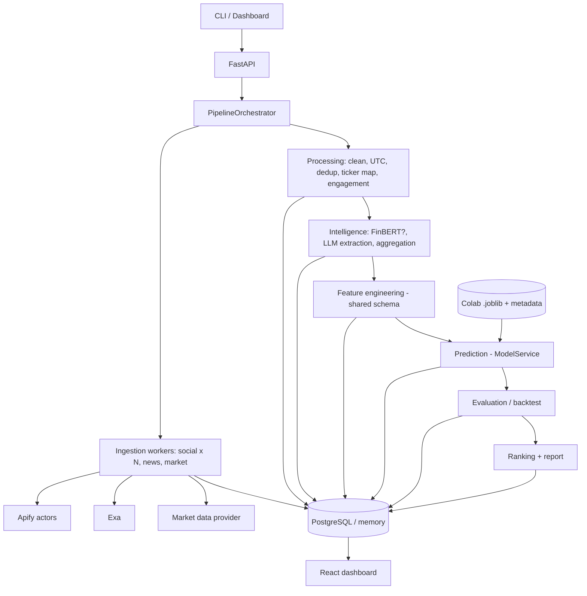

# Heng Seng Sentiment & Price Prediction Agent

Python pipeline that collects social posts (Apify) and news (Exa), extracts structured financial intelligence, combines
sentiment with market features, predicts the **next trading session's return/price** with a Colab-trained model, evaluates
predictions chronologically against a baseline, and shows a ranked visual report.

**Architecture:** hybrid modular monolith. `BaseWorker` + specialised worker classes, a central `PipelineOrchestrator`,
FastAPI, SQLAlchemy/PostgreSQL, React dashboard. Model training happens in Google Colab; the app only loads the exported
`.joblib` and runs inference.

> Predictions are statistical estimates, not financial advice.

## What is real, what is a placeholder, what is unverified

| Component | Status |
|---|---|
| Worker hierarchy, orchestrator (concurrency, isolated failures, bounded retry, partial success) | Implemented and **tested** |
| Feature schema, trading calendar, processing workers, dedup, ticker mapping, grounding guard | Implemented and **tested** |
| Model loading and compatibility checks, prediction + evaluation + backtest workers | Implemented and **tested** (with a demo sklearn artifact) |
| Apify / Exa / LLM clients | Implemented against the public REST APIs, **tested only with a fake HTTP transport**. Never run against live services. Verify with your own keys |
| **Social sources (LIHKG, Xueqiu, Naver, Daum Finance)** | **LIHKG: Operational with search mode** (actor `claude_code_reviewer/lihkg-scraper-en`). Returns thread metadata + content via keyword search. Thread mode documented but non-functional (returns 0 items). Reply text not accessible; reply counts visible in metadata. Local date filtering implemented. **Xueqiu: Operational** (actor `luminous_luxury/xueqiu-stock-scraper`). Executes separately per ticker (one stock code per run). Returns post title, engagement metrics (likes, comments, followers), timestamps. Views and reposts not available. Local date filtering implemented. **Naver Stock Discussion: Operational** (actor `hgservices/naver-stock-discussion-scraper`). Accepts multiple stock codes in single execution. Returns Korean stock discussions with title+text, engagement metrics (likes, dislikes, views), holder verification metadata. Author follower counts and reposts not available. Local date filtering implemented. **Other sources: Placeholders.** Shipped `enabled: false`, `actor_id: null`. Not operational until you select an Apify actor, run it, and fill `input_template` + `field_map` in `config/exchanges.json` |
| Market data | `csv` provider (offline) and `yfinance` adapter. **HK/KR coverage is not assumed**: run `python -m scripts.check_market_coverage` |
| FinBERT | Optional, English-centric, lazy-loaded; off by default |
| LLM extraction (Pydantic schema, retries, grounding) | Implemented. Tests exist but were **not executed** in the build sandbox (no pydantic) |
| FastAPI, SQLAlchemy repository, React dashboard | Written and syntax-checked; **not executed** in the build sandbox (see below) |
| Trained model | **None committed.** Train in Colab. A clearly labelled *demo* model on synthetic prices can be generated for offline demos |
| Exchange holidays | Not bundled. Add ISO dates to `holidays` per exchange |

The assignment names Hong Kong and South Korean communities. Both exchanges are configured (5 assets each, 2 source slots each),
but **neither has an operational social source until you complete the actor setup above.** One working exchange with two
verified sources is the minimum honest deliverable; do not claim more.

## Architecture



Design points: workers receive dependencies by constructor injection; inheritance only provides the lifecycle
(`validate -> run -> timing -> wrapped error`); the orchestrator alone owns sequencing, retries and run state.
Ingestion sources run concurrently and fail independently; transient errors (timeouts, 429, 5xx) are retried with bounded
exponential backoff, and a failed source never discards the others' data. Run status is `succeeded`, `partial` or `failed`.

### Data integrity rules (enforced in code and tests)
- All stored timestamps are UTC; source-local naive times are interpreted in the source's configured timezone.
- A post after an exchange's close (or on a weekend/holiday) belongs to the **next** session, so features for session *t* only use information available at *t*'s close. Tests verify features do not change when future bars are altered.
- News publication time is never replaced by retrieval time; articles without one are shown but excluded from features.
- Missing sentiment stays `NaN` with explicit `*_has_data` indicators and counts. It never silently becomes neutral.
- The LLM may only report positions, support/resistance and target prices stated in the text. `services/grounding.py` drops any number not present in the source and any evidence that is not a verbatim excerpt. Trader-reported levels and **calculated** technical levels are separate fields.
- Engagement weighting is bounded: `1 + log1p(min(likes + reposts, 10000))`; missing metrics give weight 1 and are flagged.

## Setup

```bash
python -m venv .venv && source .venv/bin/activate
pip install -r requirements-dev.txt
cp .env.example .env            # then fill in keys; never commit .env
```

### Try it with no credentials (demo mode, synthetic data)
```bash
python -m scripts.make_demo_artifacts            # synthetic demo model -> model_artifacts/demo/
python -m scripts.run_pipeline --exchange HKEX --demo --output demo_report.json
uvicorn app.main:app --reload                    # http://localhost:8000/docs
cd frontend && npm install && npm run dev        # http://localhost:5173 -> choose "Demo (synthetic)"
```
Demo posts, news, prices and the demo model are fabricated and labelled as such in provenance, run mode and the UI.

### Live mode
1. **Market data.** `python -m scripts.check_market_coverage` must show OK for every ticker you intend to use.
2. **Social sources.** LIHKG, Xueqiu, and Naver are operational. LIHKG uses actor `claude_code_reviewer/lihkg-scraper-en` (search mode only, thread mode non-functional). Xueqiu uses actor `luminous_luxury/xueqiu-stock-scraper` (executes separately per ticker - ONE stock code per run). Naver uses actor `hgservices/naver-stock-discussion-scraper` (accepts multiple stock codes in single execution). For other sources: pick an Apify actor, run it once in the Apify console, inspect its dataset, then set `enabled: true`, `actor_id`, `input_template` (placeholders `{queries}`, `{since_iso}`, `{until_iso}`, `{max_items}`, `{stock_code}`, `{stock_codes}`) and `field_map` (dotted paths for `id, text, timestamp, author_id, followers, likes, reposts, views, url`). Set `source_timezone` for naive timestamps. Respect each platform's terms and privacy rules.
3. **Keys.** `APIFY_API_TOKEN`, `EXA_API_KEY`, `GEMINI_API_KEY` in `.env`. Anything missing is reported as *skipped* with the reason, not hidden.
4. **Model.** Train in Colab (below) and copy the artifacts to `model_artifacts/`.
5. `python -m scripts.run_pipeline --exchange HKEX` (or `POST /api/pipeline/runs`).

### PostgreSQL (optional)
```bash
docker compose up -d postgres
# .env: STORAGE_BACKEND=database
python -m scripts.init_db
```
`STORAGE_BACKEND=memory` (default) needs no database but loses data on restart. Schema evolution via Alembic is not set up; `create_all` is used.

## Training in Colab
1. Open `notebooks/model_training.ipynb` in Colab and run it. When prompted, upload `app/ml/feature_schema.py`, `evaluation.py`, `trading_calendar.py`, the same files the app imports, so features cannot drift.
2. The notebook downloads long OHLCV history, prints a coverage table, builds features, splits chronologically (60/20/20), compares zero-return / Ridge / Random Forest / XGBoost with walk-forward validation, selects **only on train+validation**, evaluates the untouched test period once, and exports the four artifact files.
3. Without a genuine timestamped `historical_sentiment.csv` it trains a **market-only** model and says so in the metadata. Ten days of scraped posts cannot establish a sentiment-to-price relationship, so a sentiment-enhanced model is only produced from real, aligned historical sentiment.
4. Copy `xgboost_model.joblib` (or `<name>_model.joblib`, then set `MODEL_PATH`), `feature_columns.json`, `model_metadata.json`, `evaluation_metrics.json` into `model_artifacts/` and run `python -m scripts.verify_model`.

If no candidate beats the zero-return baseline the notebook prints a warning and records it in the metadata. Report that outcome honestly.

## API
| Method | Endpoint | Purpose |
|---|---|---|
| POST | `/api/pipeline/runs` | Start a run (`{"exchange":"HKEX","mode":"live"\|"demo","lookback_days":10}`), returns 202 + run id |
| GET | `/api/pipeline/runs/{run_id}` | Status, warnings, per-worker status/attempts/errors |
| GET | `/api/assets` | Exchanges, assets, and whether each social source is operational (with reason) |
| GET | `/api/assets/{ticker}/intelligence` | Extractions with evidence, daily aggregates, news |
| GET | `/api/predictions` | Latest prediction per asset + evaluation when known |
| GET | `/api/reports/latest` | Latest report (`?exchange=`, `?mode=`) |
| GET | `/health` | Liveness and whether a model is loaded |

## Tests
```bash
pytest
```
No test needs network access or API keys. Covered: base-worker lifecycle, retry/backoff, HTTP error classification, Apify/Exa request shapes, source normalisation (KST to UTC), UTC/session alignment, dedup, ticker mapping (Latin, CJK, Hangul, boundaries), grounding, feature order and no-lookahead, missing-sentiment behaviour, model loading/tamper/schema checks, malformed LLM JSON, partial source failure, retry recovery, missing model, market-data outage, and prediction-then-evaluation over time.

## Verification status of this build
The build sandbox had **no network access**, so `fastapi`, `pydantic`, `sqlalchemy`, `httpx`, `xgboost` and `pytest` could not be installed.

- **Executed and passing:** 55 tests, run with a minimal pytest-compatible runner (not pytest itself) on numpy/pandas/scikit-learn only. This includes the full orchestrated demo pipeline end to end (without LLM extraction), the notebook's training logic (run against stubbed `yfinance`/`xgboost`; on random-walk data it correctly showed no skill over the baseline), and the demo model round trip.
- **Not executed:** `tests/unit/test_extraction_service.py` and `tests/integration/test_api.py` (they skip without pydantic/FastAPI); the SQLAlchemy repository; the React app (never type-checked or built); the notebook under real XGBoost/Colab; every call to a real Apify/Exa/LLM/market-data service.

Run `pytest`, `ruff check .`, `cd frontend && npm install && npm run build` after installing, and fix anything they surface; these are the first things to check.

## Limitations
- **LIHKG:** Search mode operational, returns thread content. Reply text not accessible (actor's thread mode non-functional). Reply counts visible in metadata.
- **Xueqiu:** Fully operational. Actor accepts ONE stock code per execution - application automatically executes separately for each ticker. Comments stored in provenance; views and reposts not available.
- **Naver Stock Discussion:** Fully operational. Actor accepts multiple stock codes in single execution. Returns Korean stock discussions with holder verification metadata. Author follower counts and reposts not available.
- Social actors/field maps must be configured by you for sources other than LIHKG, Xueqiu, and Naver; none is verified here except those three.
- Holidays are not bundled; with an incomplete list the *displayed* target date may be off on holidays. Training labels and evaluation use the next actual bar, so they are unaffected.
- yfinance is an unofficial Yahoo interface and may omit, rate-limit or change data.
- Daily-bar model only; no intraday handling. Adjusted prices are used for returns when available.
- LLM extraction cost scales with posts x assets; it is capped (`extraction_max_items`, highest engagement first).
- The model's historical metrics describe its test period only and do not guarantee future accuracy.

## Submission checklist
- [x] LIHKG social source verified end to end with live Apify actor (search mode functional, thread mode non-functional documented)
- [x] Xueqiu social source implemented with per-ticker execution (one stock code per run verified)
- [x] Naver Stock Discussion source implemented with multi-ticker execution (multiple stock codes per run)
- [ ] All three sources tested with live credentials
- [ ] `check_market_coverage` output saved; model artifacts + metrics from your own Colab run committed
- [ ] `.env` absent from git history; README statuses above updated to match what you actually ran
